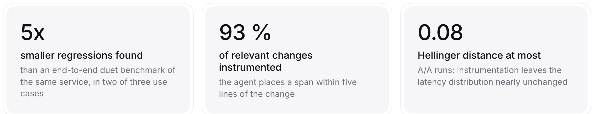
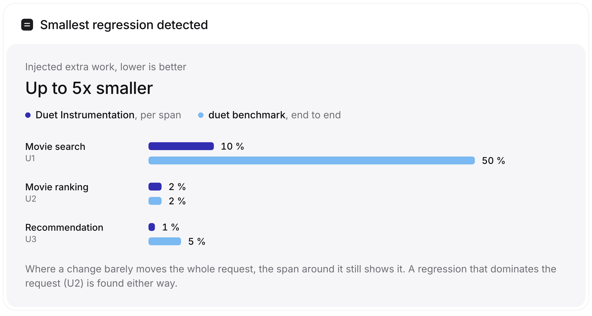
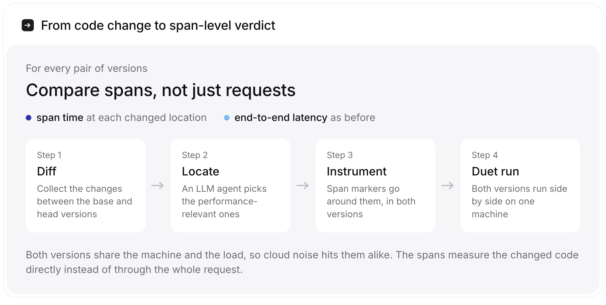

<div align="center">

# Duet Instrumentation

**Find small performance regressions in cloud services by measuring the code that changed**

[](https://arxiv.org/abs/2605.18397)
[](https://arxiv.org/abs/2605.18397)
[](LICENSE)
[](pyproject.toml)
[](measure.template.ts)

</div>

Application benchmarks time whole requests. A change that adds a few percent of work to one function disappears in the noise of I/O, the database and a shared cloud machine, so it reaches production unnoticed and adds up release after release.

Duet Instrumentation reads the diff between two versions, lets an LLM agent pick the changes that can affect performance, and puts span markers around them in both versions. Both versions then run side by side on the same machine under the same load, a [duet benchmark](https://doi.org/10.1145/3358960.3379132), and the spans are compared directly. The end-to-end latency is still measured, so nothing is lost.

<picture>
  <source media="(prefers-color-scheme: dark)" srcset="docs/results-dark.png">
  
</picture>

<picture>
  <source media="(prefers-color-scheme: dark)" srcset="docs/detection-dark.png">
  
</picture>

## How it works

<picture>
  <source media="(prefers-color-scheme: dark)" srcset="docs/how-it-works-dark.png">
  
</picture>

The prototype supports TypeScript services. It ships with a testbed, a movie search, ranking and recommendation service (`examples/movie/`), whose regressions have adjustable severity, so detection can be tested against known ground truth.

## Use it with Claude Code

The fastest way in: a Claude Code skill that runs the whole method on your own repository, in any language Claude can edit. It needs Docker or two free ports, Python 3, and no API keys besides Claude's.

```text
/plugin marketplace add s3bastiankoch/duet-instrumentation
/plugin install duet@duet-instrumentation
```

Then, in your repository:

```text
/duet:instrument main HEAD
```

or just ask "did this branch make the search endpoint slower?". Claude reads the diff, shows you which changes it will measure, puts the same span markers into both versions ([TypeScript, Python, Go, Java](skills/instrument/markers/README.md)), runs both side by side under a paired load, and reports each span with the paper's bootstrap test. Nothing is committed; everything happens in `.duet/`.

A run on a toy service whose new version does 3 % more work in one function, hidden behind noisy I/O:

| | name | base median | head median | change | 95% interval | verdict |
|---|---|---:|---:|---:|---|---|
| span | `search.fetch` | 7.283 ms | 7.319 ms | +0.17% | [−0.73%, +0.80%] | no change |
| span | `search.rank` | 0.944 ms | 0.997 ms | **+3.00%** | [+2.79%, +3.17%] | **slower** |
| end-to-end | `/search` | 9.017 ms | 9.045 ms | +0.21% | [−0.15%, +0.79%] | no change |

The request as a whole shows nothing; the span around the changed function shows the 3 %.

Without the plugin, copy [`skills/instrument/`](skills/instrument) to `~/.claude/skills/instrument/`. The skill's scripts (`duet_load.py`, `analyze.py`) use only the Python standard library and work on their own too.

## The research prototype

The CLI used in the paper (`otel-agent`) instruments TypeScript services with an LLM agent built on smolagents and runs the duet on two cloud VMs.

### Quickstart

#### Prerequisites

- **Python**: 3.12 or newer
- **uv**: Python package manager (`https://github.com/astral-sh/uv`)
- **Docker**: with `docker compose`
- **LLM credentials**: set at least one provider key (e.g., `OPENAI_API_KEY` or `ANTHROPIC_API_KEY`)
- **Optional (recommended)**: `bun` for TypeScript syntax checks during instrumentation

#### Install

```bash
uv sync
```

#### Sanity check

```bash
uv run otel-agent doctor
```

#### Prepare + instrument base/head (default: JSON mode using `config.yml`)

`otel-agent run` is **config-driven**. By default, this repo ships a `config.yml` that points at `examples/movie` and a mock changeset.

```bash
uv run otel-agent run -c config.yml
```

This writes a working directory (by default `.otel-agent/`) containing:

- `base/` and `head/` (prepared app trees)
- `perf_marker_plan.json` (planned span anchors)
- `docker-compose.experiment.yml` (merged duet compose; base/head + infra)

## Reproducing the paper

The experiments run on two cloud VMs (provisioned with Terraform):

- **SUT VM**: runs the duet docker compose (base/head + MongoDB)
- **Loadgen VM**: runs `k6` and streams results back

The scripts in `scripts/` automate the full pipeline:

- `otel-agent run` (prepare + optional instrumentation)
- provision infra via Terraform (GCP or STACKIT)
- deploy artifacts to the SUT VM and run the duet setup
- run `k6` from the loadgen VM
- download logs + span databases
- run `otel-agent eval` and write plots/reports

### Experiment map (paper E1--E9)

For quick orientation, the paper's experiments map to this repository as follows:

- **E1--E3 (instrumentation quality)**: run instrumentation + localization only with `scripts/run_instrumentation_eval.sh`; aggregate with `scripts/analyze_localization_reports.sh` (or `scripts/analyze_localization_reports.py`).
- **E4--E6 (regression sensitivity)**: run the full pipeline with `scripts/run_experiment.sh` across severity levels; re-aggregate span-level results with `scripts/run_eval_folder.sh`.
- **E7--E9 (A/A overhead)**: compare instrumented vs uninstrumented runs (0% intended change) using `scripts/run_experiment_single_instrument.sh`, then inspect `k6_eval_report*.json` and Q-Q plots.

Key experiment folders:

- `localization-experiments/`: E1--E3 localization outputs (`localization_report.json`) grouped by severity.
- `perf-detection-experiments/`: E4--E6 full detection runs (`eval_report.json`, `k6_eval_report.json`) plus per-severity aggregates (`eval_report_combined.json`).
- `overhead-base-experiments/`: source runs used for A/A overhead comparisons.
- `overhead-experiments-aggregate/`: aggregated A/A k6 analysis (`k6_eval_report_aggregate.json` and per-run reports).
- `results/`: default output location for newly executed experiments.

### Prerequisites

- **Terraform** installed locally
- Provider credentials configured:
  - **GCP**: see `infrastructure/gcp/README.md`
  - **STACKIT**: not used for experiments, not sufficiently documented
- A provider-specific `terraform.tfvars` file present (the scripts expect it):
  - `infrastructure/gcp/terraform.tfvars`
  - or `infrastructure/stackit/terraform.tfvars`

### Full experiment (instrument → k6 → span eval → localization metrics)

```bash
scripts/run_experiment.sh \
  --jwt-secret "unused" \
  --severity 5 \
  --pinning-strategy isolated
```

Notes:

- `--severity PCT` selects `examples/mock_git/movie_perf_<pct>pct.json`.
- `--pinning-strategy isolated` uses CPU topology on the SUT VM to pin base/head/infra to dedicated cores.
- For constant request rate, use `--load-mode rps --target-rps <N>` (see `scripts/run_experiment.sh --help`).

### Lightweight experiment (k6 only; no span instrumentation)

```bash
scripts/run_simple_experiment.sh \
  --jwt-secret "unused" \
  --severity 5 \
  --pinning-strategy isolated
```

### Cleanup (if an experiment was interrupted)

```bash
scripts/run_experiment.sh --destroy <experiment-id>
```

## Outputs and how to re-run evaluation

Each run writes a self-contained folder under `results/`, for example:

```text
results/5/experiment_exp-abc12345_20260208_170554/
  experiment_metadata.json
  docker-compose.experiment.yml
  duet-k6.jsonl
  k6_eval_report.json
  base-spans/   # extracted SQLite *.db* bundles
  head-spans/
  eval_report.json
  localization_report.json
  *.png         # plots
```

Re-run eval for an existing experiment (picks the most recent matching folder):

```bash
scripts/run_eval.sh <experiment-id>
scripts/run_k6_eval.sh <experiment-id>
```

Re-evaluate a whole folder of experiments:

```bash
scripts/run_eval_folder.sh ./results/5
```

## Configuration (`config.yml`)

`otel-agent run` reads a YAML config (`otel-agent.yml` or `config.yml`). Paths are resolved **relative to the config file directory**.

Key fields (see `src/config.py`):

- **`repository_dir`**: local app folder (JSON mode)
- **`mock_changes_file`**: JSON changeset describing diffs to apply (JSON mode)
- **`repository_url`**, **`base_ref`**, **`head_ref`**: git mode inputs (alternative to JSON mode)
- **`entrypoint`**: entrypoint file relative to app root (used for instrumentation context)
- **`instrument`**: enable/disable span marker insertion
- **`model`**: LLM model identifier used by the analysis pipeline
- **`analysis_chunk_size`**, **`analysis_max_workers`**: parallelization controls for analysis
- **`duet_*`**: docker resource limits, ports, and optional CPU pinning

## CLI reference

- **`otel-agent run`**: prepare base/head, optionally plan + insert perf markers, and generate duet compose
- **`otel-agent eval`**: compare performance samples (span DBs or k6 outputs) and optionally plot results
- **`otel-agent localize`**: compute semantic localization metrics of planned spans vs changed lines/perfect spans
- **`otel-agent doctor`**: environment + dependency checks

Run `--help` on any command for details:

```bash
uv run otel-agent --help
uv run otel-agent run --help
uv run otel-agent eval --help
```

## Repository layout

```
skills/instrument/           Claude Code skill: SKILL.md, span markers, paired load, analysis
.claude-plugin/              plugin and marketplace manifests
src/                         otel-agent CLI: change extraction, LLM analysis, instrumentation, eval
examples/movie/              TypeScript testbed service with configurable regressions
examples/mock_git/           JSON changesets, one per severity level
scripts/                     end-to-end experiment runners and offline evaluation
infrastructure/              Terraform for the benchmark VMs (GCP, STACKIT)
localization-experiments/    E1–E3 results
perf-detection-experiments/  E4–E6 results
overhead-base-experiments/   E7–E9 source runs
tests/                       unit tests (uv run pytest)
```

## Citation

If you use Duet Instrumentation, please cite:

```bibtex
@inproceedings{koch2026duet,
  author    = {Koch, Sebastian and Japke, Nils and Bermbach, David},
  title     = {{Duet Instrumentation}: An Agentic Approach to Improving
               Sensitivity in Cloud Service Benchmarking},
  booktitle = {Proceedings of the 2026 IEEE International Conference on
               Cloud Engineering (IC2E)},
  year      = {2026},
  publisher = {IEEE},
  eprint    = {2605.18397},
  archivePrefix = {arXiv}
}
```

## License

[MIT](LICENSE).

<sub>Scalable Software Systems Research Group, TU Berlin.</sub>
